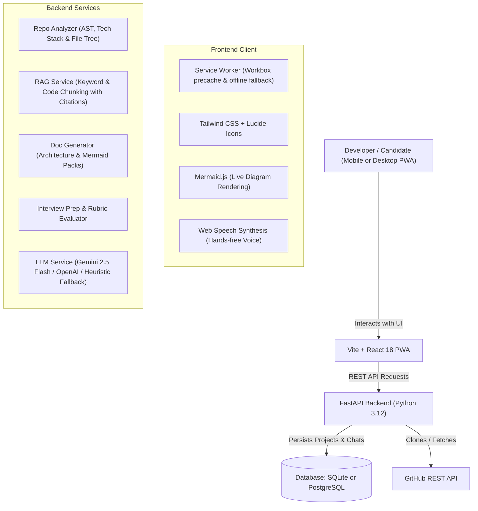

# 📽️ Projector AI

> **The Interview-Ready Repo Companion, Conversational Codebase & Architecture Generator**  
> *Installable PWA • Talk to your code on the go • Master architectural documentation with live Mermaid diagrams*

---

[](https://fastapi.tiangolo.com)
[](https://react.dev)
[](https://web.dev/progressive-web-apps/)
[](https://tailwindcss.com)
[](https://www.postgresql.org)
[](https://ai.google.dev)
[](https://www.docker.com)

---

## 🎯 The Problem

You have an upcoming technical interview in 30 minutes. You're riding transit or sitting in the company lobby. You don't have your heavy workstation open with your IDE running, but interviewers are about to ask you deep questions about projects you built 6 months ago:
- *"Walk me through the architecture of your distributed ledger project."*
- *"Why did you choose FastAPI over Flask or Django?"*
- *"How is database concurrency and transaction rollback handled?"*
- *"What was the single hardest technical bottleneck and tradeoff?"*

**Projector AI** solves this. It's an installable Progressive Web App (PWA) that connects to your GitHub repositories, local codebases, or uploaded project archives. You can **literally talk to your project**, get answers with **exact file & line citations**, listen to voice narrations hands-free, study **repository-tailored flashcards**, and export **executive architectural documentation** with live interactive Mermaid diagrams.

---

## ✨ Key Capabilities

### 1. 🗣️ "Talk to Your Project" (Interactive Codebase Q&A)
- **3 Specialized Modes**:
  - 🎯 **Interview Grill Mode**: The AI acts as a tough Senior/Staff Engineer questioning your design choices, edge cases, and architectural tradeoffs.
  - 🔍 **Codebase Explorer**: Ask anything (*"Where is auth middleware configured?"*, *"Explain the ledger service algorithm"*).
  - ⚡ **Waiting-Room Quick Recall**: Ultra-punchy 2-sentence answers designed for rapid memory refreshment right before entering an interview.
- **Precise Code Citations**: Answers include clickable pills (`[backend/main.py:12]`) that open the file viewer directly at the relevant lines.
- **Voice Narration (Text-to-Speech)**: Listen to explanations spoken out loud while walking or traveling.

### 2. 📑 "Doc Studio" (Deep Architecture & System Design Generator)
Automatically generates 6 comprehensive documentation files for any repository:
1. **Executive Architecture & Technical Design**: System topology, paradigm, data persistence, and security.
2. **Interactive Mermaid Diagrams**: High-level component diagrams, request lifecycle sequence diagrams, and state workflows rendered live with zoom and code export.
3. **Module & Directory Guide**: Clear explanations of what each folder and file does.
4. **Decisions & Tradeoffs (The "Why")**: The technical rationale behind choices and what you would do differently in v2.0 (essential for Staff-level discussions).
5. **Interview Master Cheatsheet**: 60-second STAR format elevator pitches and top 5 toughest questions with model answers.
6. **API Contracts & Specifications**: Discovered endpoints, request/response models, and environment configuration.
- **One-Click Export**: Download all generated documentation as a bundled `.zip` of Markdown files.

### 3. 🎓 Interview Prep Arena & Mock Simulator
- **3D Flip Flashcards**: Repository-specific flashcards categorized by *Architecture, Tradeoffs, Scaling, Security, Debugging, and STAR Stories*.
- **Mastery Tracking**: Track cards as *Unseen*, *Still Learning*, or *Mastered* with offline persistent storage.
- **Mock Interview Simulator**: Practice typing or speaking answers to technical questions. The AI grades your response on a 1-10 scale with a hiring verdict (*Strong Hire / Hire / Needs Work*), identifies strengths & gaps, and provides an ideal Staff-level model answer.

### 4. 📂 Flexible Code Ingestion
- **Public GitHub URL**: Paste any GitHub repo URL (`https://github.com/fastapi/fastapi` or `owner/repo`).
- **GitHub Account & PAT**: Connect your token to access private repositories or avoid rate limits.
- **Drag-and-Drop ZIP**: Upload a zipped project from any phone, tablet, or laptop.
- **Local Filesystem Path**: Ingest any directory on your machine.
- **1-Click Interactive Demo**: Instantly test with the built-in `FinTrack-Core` financial ledger sample repository.

### 5. 📱 Progressive Web App (PWA)
- Install to Home Screen on iOS, Android, macOS, and Windows.
- Precached assets via Workbox service worker.
- Offline storage for previously generated docs, flashcards, and notes.

---

## 🏗️ Architecture & Tech Stack



- **Frontend**: Vite 6, React 18, Tailwind CSS, `@vite-pwa`, `mermaid`, `lucide-react`, `react-markdown`, `remark-gfm`
- **Backend**: FastAPI, Python 3.12, Uvicorn, SQLAlchemy 2.0, Pydantic v2
- **Database**: SQLite by default (zero setup), PostgreSQL production-ready via `DATABASE_URL`
- **AI Engine**: Google Gemini API (`gemini-2.5-flash`), OpenAI API, with built-in heuristic fallback engine ensuring 100% functionality even before keys are entered.

---

## 🚀 Quickstart Guide

### Option 1: Local Development (2 Minutes)

#### 1. Clone the repository
```bash
git clone https://github.com/your-username/projector.git
cd projector
```

#### 2. Setup Backend (FastAPI)
```bash
# Windows
python -m venv backend\venv
backend\venv\Scripts\activate
pip install -r backend\requirements.txt
python backend\run.py

# macOS / Linux
python3 -m venv backend/venv
source backend/venv/bin/activate
pip install -r backend/requirements.txt
python backend/run.py
```
*The FastAPI backend will start at `http://127.0.0.1:8000` (API docs at `/docs`).*

#### 3. Setup Frontend (Vite React PWA)
In a new terminal window:
```bash
cd frontend
npm install
npm run dev
```
*Open `http://localhost:5173` in your browser!*

---

### Option 2: Docker Compose (Full Stack with PostgreSQL)

To run the complete production stack (PostgreSQL + FastAPI + Nginx PWA Frontend):

```bash
docker-compose up --build
```

- **Web App**: `http://localhost` (or `http://localhost:3000`)
- **API Backend**: `http://localhost:8000`
- **API Docs**: `http://localhost:8000/docs`
- **PostgreSQL**: `localhost:5432`

---

## ⚙️ Configuration & Environment Variables

Copy `backend/.env.example` to `backend/.env` (or configure via the in-app **Settings** page):

| Variable | Description | Default |
|---|---|---|
| `DATABASE_URL` | SQLite or PostgreSQL connection string | `sqlite:///backend/storage/projector.db` |
| `GEMINI_API_KEY` | Google Gemini API Key | *Optional (Smart heuristic used if omitted)* |
| `GEMINI_MODEL` | Gemini Model identifier | `gemini-2.5-flash` |
| `OPENAI_API_KEY` | OpenAI API Key | *Optional* |
| `GITHUB_TOKEN` | GitHub PAT for private repos and higher rate limits | *Optional* |

> 💡 **Zero-Friction Out of the Box**: You don't need any API keys or PostgreSQL setup to test the app immediately. Projector includes a smart heuristic fallback engine and SQLite database that works right away!

---

## 📱 Installing the PWA on Mobile / Desktop

1. Open the app in **Chrome**, **Safari**, or **Edge** on your phone or computer.
2. Click the **"Install Projector PWA"** banner at the bottom (or tap the browser menu $\rightarrow$ **"Add to Home Screen"**).
3. The app is now installed on your device with an app icon, standalone fullscreen window, and offline caching for your project documents and interview flashcards!

---

## 🚢 Publishing & Cloud Deployment

### Deploying to Railway / Render / Fly.io
1. Connect your GitHub repository to Railway or Render.
2. Select **Docker Compose** or deploy the two services separately:
   - **Backend**: Set Dockerfile to `Dockerfile.backend`, expose port `8000`. Add environment variables `DATABASE_URL` (provisioned PostgreSQL) and `GEMINI_API_KEY`.
   - **Frontend**: Set Dockerfile to `Dockerfile.frontend` or deploy static build (`frontend/dist`) to **Vercel** / **Netlify** with `VITE_API_URL=https://your-backend.railway.app`.

---

## 📄 License

MIT License. Free to use, adapt, and deploy for personal and commercial projects.
