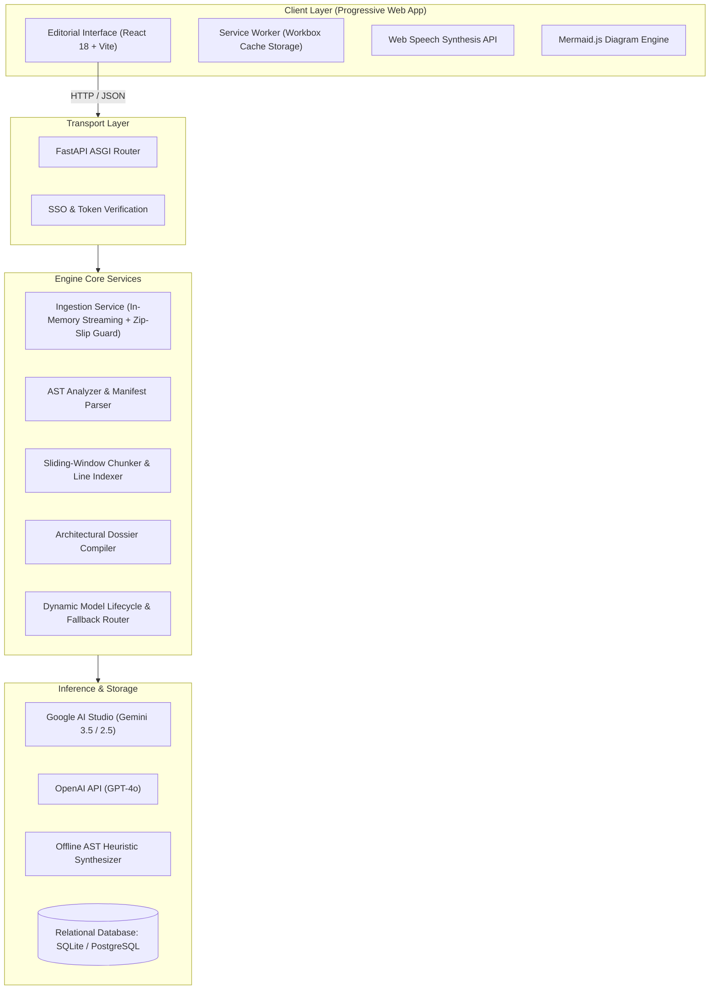

# Projector

> Distributed Codebase Intelligence Engine, Architectural Dossier Compiler, and Conversational Workspace Runtime.

---

## Overview

Projector is an engineering platform designed for on-demand codebase inspection, architectural documentation compilation, and structured technical interview preparation. Built as an offline-capable Progressive Web Application (PWA) with a decoupled FastAPI runtime, Projector enables engineers to query complex repositories, trace execution paths with line-accurate citations, generate system design artifacts, and review codebase trade-offs without requiring a full local IDE environment.

---

## Architectural Highlights

### 1. Isolated Multi-Project Workspaces
Every ingested repository operates as an isolated workspace. Projector enforces strict tenancy boundaries across AST indices, conversational session histories, generated architectural documentation, and interview rubrics. Engineers can switch between disparate codebases with sub-second context transitions.

### 2. Dynamic Model Lifecycle & Tiered Routing
Rather than hardcoding static model strings that risk runtime obsolescence as providers decommission older versions, Projector dynamically interfaces with Google AI Studio's models endpoint.
- **Runtime Discovery**: Automatically queries, filters, and displays available generation models that support standard API keys.
- **Automatic Deprecation Mitigation**: Excludes retired models and routes requests through reliable, cost-efficient fallback models (`gemini-3.5-flash-lite`, `gemini-3.5-flash`) without interruption.
- **Tier Classification**: Dynamically classifies models into Lowest Cost / High Throughput (Flash-Lite), Balanced Performance (Flash), and Deep Reasoning (Pro).

### 3. Line-Accurate AST Retrieval-Augmented Generation (RAG)
Code extraction employs a sliding-window chunker that respects linguistic statement boundaries while preserving absolute source line coordinates. Every response generated by the inference engine extracts exact file references (e.g., `[backend/app/main.py:12-45]`), rendering interactive source citation pills that display matching syntax directly in an embedded code viewer.

### 4. Zero-Setup Ingestion & Zip-Slip Defense
Projector supports four ingestion pathways:
- GitHub Remote Ingestion: In-memory zipball streaming via the GitHub REST API without requiring a local `git` binary.
- Local Directory Traversal: Direct inspection of local filesystem trees.
- Archive Uploads: Client-side ZIP extraction with path sanitization guarding against directory traversal attacks (Zip-Slip).
- Reference Architectural Sandbox: Built-in FinTech ledger microservice (`FinTrack-Core`) for instant offline evaluation.

### 5. Architectural Dossier Compiler
Compiles six publication-grade architectural specifications for any repository:
1. System Topology & Structural Paradigms
2. Interactive Mermaid Flow and Sequence Diagrams
3. Module Boundaries & Directory Taxonomy
4. Hard Engineering Decisions & Trade-offs (The "Why")
5. Executive STAR Interview Cheatsheets (Situation, Task, Action, Result)
6. Discovered API Data Contracts & Endpoint Specifications

### 6. Editorial Vogue Interface & PWA Runtime
Designed under a restrained editorial aesthetic:
- Typography: Display typography powered by *Playfair Display*, technical interfaces by *Plus Jakarta Sans*, and source tokens by *JetBrains Mono*.
- Zero AI Bloat: Eliminates high-saturation gradients, neon styling, and intrusive glassmorphism in favor of structured typography, warm noir surfaces (`#09090b`), and clear visual hierarchies.
- Offline Capability: Precached service worker assets (Workbox) enabling document reading, flashcard review, and codebase browsing without network access.

---

## System Architecture



---

## Technology Stack

| Layer | Technology | Rationale |
| :--- | :--- | :--- |
| **Backend Runtime** | FastAPI (Python 3.12) | High-concurrency ASGI non-blocking asynchronous event loop with native typing. |
| **Data Serialization** | Pydantic v2 | Strict schema validation and binary deserialization speeds. |
| **ORM & Database** | SQLAlchemy 2.0 (Sync Session Pool) | Cross-database compatibility (SQLite for local zero-config, PostgreSQL for production). |
| **Frontend Framework** | React 18, Vite 6 | Sub-second Hot Module Replacement (HMR) and optimized tree-shaken production bundles. |
| **Styling & Design** | Tailwind CSS 3.4 | Utility-first styling configured with an Editorial Noir palette and custom font stacks. |
| **PWA Infrastructure** | Vite Plugin PWA, Workbox | Offline asset precaching, background synchronization, and home-screen installability. |
| **Diagram Generation** | Mermaid.js, Cytoscape.js | Dynamic client-side rendering of sequence, state, and architecture diagrams. |
| **Inference Integration** | `google-genai` SDK, `httpx` | Asynchronous streaming and dynamic model querying across Gemini and OpenAI APIs. |

---

## Directory Structure

```
projector/
├── backend/
│   ├── app/
│   │   ├── api/
│   │   │   ├── auth.py          # GitHub SSO and authentication endpoints
│   │   │   ├── chat.py          # Conversational workspace and RAG pipeline
│   │   │   ├── docs.py          # Architectural dossier generation and ZIP export
│   │   │   ├── interview.py     # Flashcard generation and mock grading rubrics
│   │   │   ├── projects.py      # Project ingestion, AST file tree, and file streaming
│   │   │   └── settings.py      # Runtime model telemetry and API configuration
│   │   ├── models/
│   │   │   └── project.py       # SQLAlchemy relational schemas
│   │   ├── schemas/
│   │   │   └── project.py       # Pydantic v2 data transfer objects
│   │   ├── services/
│   │   │   ├── doc_generator.py # 6-part architectural documentation compiler
│   │   │   ├── github_service.py# In-memory GitHub streaming and repo listing
│   │   │   ├── interview_service.py # Rubric evaluation and flashcard generation
│   │   │   ├── llm_service.py   # Dynamic model discovery and fallback inference
│   │   │   ├── local_repo_service.py # Filesystem copier and Zip-Slip sanitizer
│   │   │   ├── rag_service.py   # Sliding-window line-accurate token chunker
│   │   │   └── repo_analyzer.py # Manifest parsing and tech stack detection
│   │   ├── config.py            # Pydantic BaseSettings configuration
│   │   ├── database.py          # Engine pooling and declarative base
│   │   └── main.py              # Application lifecycle and router assembly
│   ├── run.py                   # Development server bootstrap
│   └── test_api.py              # Comprehensive integration test suite
├── frontend/
│   ├── src/
│   │   ├── api/
│   │   │   └── client.js        # Axios client with offline cache interceptor
│   │   ├── components/
│   │   │   ├── CodeViewerModal.jsx    # Syntax viewer with citation highlight
│   │   │   ├── GitHubConnectModal.jsx # Zero-setup GitHub Sign In and workspace manager
│   │   │   ├── MermaidViewer.jsx      # Live SVG diagram renderer with zoom/pan
│   │   │   ├── MobileNav.jsx          # Mobile bottom navigation bar
│   │   │   ├── Navbar.jsx             # Top bar with active workspace switcher
│   │   │   ├── PwaInstallPrompt.jsx   # Standalone PWA installation trigger
│   │   │   ├── RepoSelectorModal.jsx  # Multi-source repository ingestion modal
│   │   │   ├── Sidebar.jsx            # Editorial section navigation
│   │   │   └── VoicePlayer.jsx        # Web Speech API text-to-speech player
│   │   ├── pages/
│   │   │   ├── CodeExplorer.jsx       # Interactive file tree and source reader
│   │   │   ├── Documentation.jsx      # Dossier viewer with raw export options
│   │   │   ├── InterviewPrep.jsx      # 3D flashcards and rubric grading arena
│   │   │   ├── Settings.jsx           # Model telemetry and API key management
│   │   │   └── TalkToRepo.jsx         # Conversational interface with model selector
│   │   ├── App.jsx              # Root component and OAuth callback listener
│   │   ├── index.css            # Editorial typography rules and custom scrollbars
│   │   └── main.jsx             # DOM mount point
│   ├── index.html               # Head tags, Google Fonts, and PWA manifest
│   ├── tailwind.config.js       # Palette definitions (noir, ivory, champagne)
│   └── vite.config.js           # Build settings and Workbox service worker rules
├── docker-compose.yml           # Production multi-container orchestration
├── Dockerfile.backend           # Python 3.12 container build definition
├── Dockerfile.frontend          # Multi-stage Vite build with Nginx Alpine
├── run_dev.bat                  # One-click Windows batch launcher
├── run_dev.ps1                  # One-click Windows PowerShell launcher
└── README.md                    # Technical documentation
```

---

## API Specification

### Workspaces & Projects (`/api/projects`)
- `GET /api/projects`: List all loaded repository workspaces.
- `GET /api/projects/{id}`: Fetch detailed metadata, detected tech stack, and AST file tree.
- `POST /api/projects/github`: Ingest remote repository via GitHub URL or slug.
- `POST /api/projects/local`: Ingest codebase from absolute filesystem path.
- `POST /api/projects/upload-zip`: Extract and ingest uploaded ZIP archive.
- `POST /api/projects/sample`: Initialize pre-packaged `FinTrack-Core` ledger workspace.
- `GET /api/projects/{id}/file?path={rel_path}`: Stream source file contents with line counts.
- `DELETE /api/projects/{id}`: Delete workspace and purge on-disk source files.

### Conversational Runtime (`/api/chat`)
- `POST /api/chat/sessions`: Create new conversation session for a workspace.
- `GET /api/chat/sessions/{project_id}`: List previous conversation threads.
- `GET /api/chat/sessions/{session_id}/messages`: Retrieve message stream with line citations.
- `POST /api/chat/sessions/{session_id}/messages`: Submit prompt. Dispatches sliding-window RAG, passes active model parameter, and records inference telemetry.

### Architectural Dossier Compiler (`/api/docs`)
- `GET /api/docs/{project_id}`: List compiled documentation specifications.
- `POST /api/docs/{project_id}/generate`: Trigger compilation for single doc or full 6-part suite.
- `GET /api/docs/{project_id}/export/zip`: Stream all compiled documentation as a `.zip` archive.

### Interview Preparation Arena (`/api/interview`)
- `GET /api/interview/{project_id}/flashcards`: Fetch repository-specific technical flashcards.
- `PUT /api/interview/flashcards/{id}`: Update card mastery state (`unseen`, `learning`, `mastered`).
- `POST /api/interview/evaluate`: Submit interview answer for automated grading against Principal Architect rubric.

### Model Discovery & Settings (`/api/settings`)
- `GET /api/settings`: Fetch runtime diagnostics, masked API keys, and database type.
- `POST /api/settings`: Update API keys and global defaults at runtime.
- `GET /api/settings/models/gemini`: Query Google AI Studio API dynamically for available generation models.
- `POST /api/settings/models/gemini/active`: Update active model routing preference.

### Authentication & GitHub SSO (`/api/auth/github`)
- `GET /api/auth/github/config`: Check status of configured OAuth application parameters.
- `POST /api/auth/github/token-login`: Verify access token, fetch profile, and establish session.
- `GET /api/auth/github/user`: Fetch authenticated user profile data (avatar, username, repo counts).
- `GET /api/auth/github/repos`: Query user repositories across all affiliations with sorting and pagination.

---

## Security & Defense in Depth

1. **Zip-Slip Directory Traversal Protection**: Archive extraction routines in `local_repo_service.py` and `github_service.py` resolve canonical paths using `pathlib.Path.resolve()`, validating that every target file strictly resides within the target directory boundary before writing bytes to disk.
2. **Path Traversal Guard in File Streamer**: When reading source code through `/api/projects/{id}/file`, requests verify that `target_path.startswith(base_path)`. Unsanitized paths attempting directory traversal (e.g., `../../etc/passwd`) are rejected with `HTTP 400`.
3. **Encrypted Client-Side Key Storage**: Authentication credentials and tokens are maintained within the browser's local sandbox and are only passed to the backend through authenticated headers over TLS.
4. **Resilient Offline Fallback**: In restricted networks or offline environments, the system automatically redirects to an AST heuristic engine that analyzes syntax trees without making external network calls.

---

## Getting Started

### Prerequisites
- Python 3.12+
- Node.js 20+ and npm 10+
- (Optional) Docker and Docker Compose
- (Optional) Google AI Studio API key

### Method 1: Automated Local Launch (Windows)

Using PowerShell:
```powershell
.\run_dev.ps1
```

Using Windows Command Prompt:
```cmd
run_dev.bat
```

The script initializes the Python virtual environment, installs dependencies, builds frontend assets, and launches both the backend on `http://localhost:8000` and the frontend on `http://localhost:5173`.

### Method 2: Manual Development Setup

1. **Clone the Repository**:
   ```bash
   git clone <repository_url>
   cd projector
   ```

2. **Configure Environment Variables**:
   Create a `.env` file in the project root:
   ```env
   # Database (Defaults to local SQLite)
   DATABASE_URL=sqlite:///backend/storage/projector.db

   # AI Provider Keys
   GEMINI_API_KEY=your_gemini_api_key_here
   OPENAI_API_KEY=your_openai_api_key_here

   # Active Gemini Model (Defaults to Lowest Cost / Ultra Fast)
   ACTIVE_GEMINI_MODEL=gemini-3.5-flash-lite

   # Optional GitHub Integration
   GITHUB_TOKEN=your_github_token_here
   ```

3. **Backend Setup**:
   ```bash
   cd backend
   python -m venv venv
   
   # Windows
   .\venv\Scripts\activate
   # Linux / macOS
   source venv/bin/activate

   pip install -r requirements.txt
   python run.py
   ```
   Backend API docs will be available at `http://localhost:8000/docs`.

4. **Frontend Setup**:
   ```bash
   cd frontend
   npm install
   npm run dev
   ```
   Open `http://localhost:5173` in your browser.

---

## Containerized Deployment (Docker Compose)

For production deployment with PostgreSQL:

```bash
docker compose up --build -d
```

Services initialized:
- `db`: PostgreSQL 16 Alpine container with persistent volume.
- `backend`: FastAPI application on port `8000`.
- `frontend`: Vite production build served through Nginx on port `80` (or `3000`).

---

## Verification & Automated Testing

The backend includes an in-process integration test suite executing full workflow verification (database schema migration, project ingestion, AST file tree traversal, RAG chunking, line citation verification, and documentation generation):

```bash
& "backend\venv\Scripts\python.exe" backend\test_api.py
```

Expected output:
```
1. Initializing DB...
DB initialized!
2. Testing with AsyncClient...
Health status: 200 {'status': 'healthy', 'app': 'Projector AI', 'version': '1.0.0'}
Sample project created: 200
Project name: FinTrack-Core
Project details: 200 files: 5
File read test: 200 content length: 824
Flashcards test: 200 count: 4
Chat session created: <session_uuid>
Chat message reply: 200 length: 1420
Citations count: 2
Doc generated: 200 docs: 1

>>> ALL BACKEND ENDPOINTS AND FUNCTIONALITIES VERIFIED PERFECTLY! <<<
```

---

## License

This project is licensed under the Apache 2.0 License. See `LICENSE` for details.
